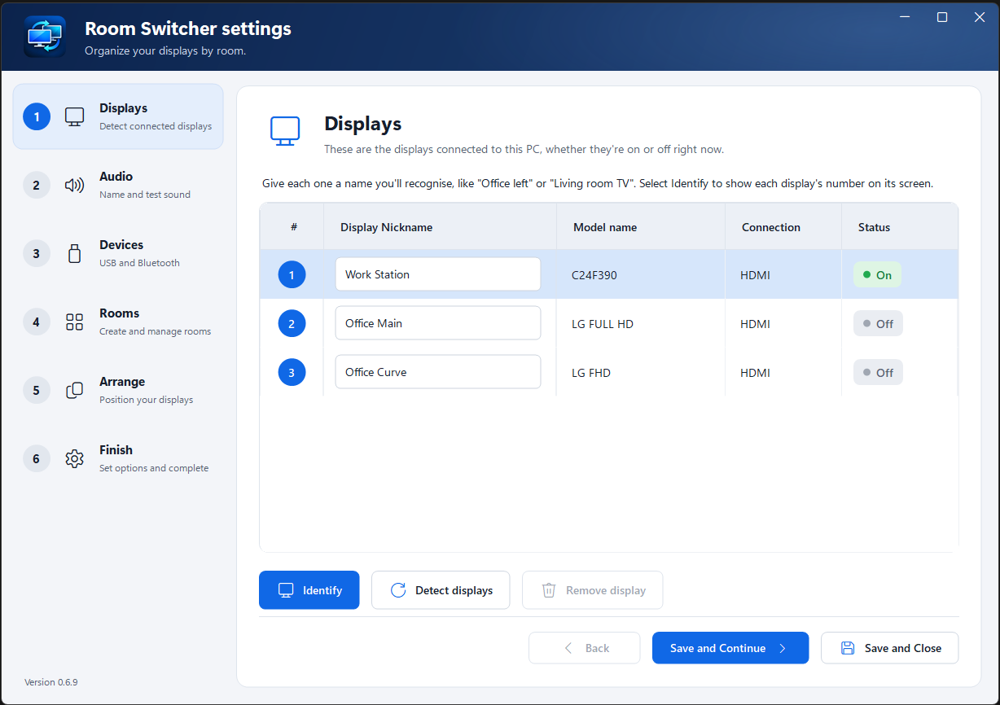
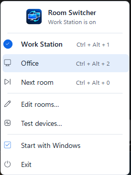
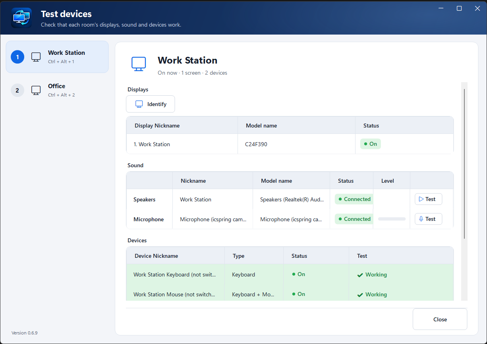

# Room Switcher

**One PC, several workstations. Like a KVM switch in reverse, in software.**

Room Switcher lets you set up several workstations, at home or in the office, that all run from the same PC. A KVM switch shares one desk between several computers; Room Switcher does the opposite and shares one computer between several desks.

Each desk's displays, speakers, microphone, keyboard, mouse and webcam stay cabled to the PC. You group them into named **rooms**, such as "Office" (two displays side by side) or "Living Area" (the TV and its speakers), and pick a room from the tray icon or with a keyboard shortcut. That room's displays come on, Windows switches to its speakers and microphone, and its devices are turned on. The other displays go dark ("No signal") and any devices you chose are turned off. Each room remembers where your open windows were, so nothing is left stranded on a display that's off.

Good to know:
- **Every desk is still wired to the PC.** Room Switcher doesn't send video or USB anywhere; desks further away need long cables or HDMI/USB extenders.
- **One room is on at a time.** It's for one person moving between desks, not for several people using the PC at once.
- Free and source-available, for Windows.

- Any number of displays and rooms. A display can be in many rooms, set up differently in each.
- Extend, duplicate, or mix both in one room (two screens side by side, with a third display duplicating the first).
- Combinations your graphics card can't run are flagged in plain words before you can use them.
- Audio and Devices steps: give nicknames to and test your speakers, microphones, keyboards, mice, webcams and Bluetooth devices.
- Built-in arranger: drag a room's screens into place and set resolution, refresh rate, orientation and scale, without the other displays getting in the way.
- Devices per room: list the keyboards, mice, webcams and other USB or Bluetooth devices each room uses, and let rooms turn chosen ones on and off (a webcam, a second keyboard).
- Test devices: pick a room and check everything it uses (identify its displays, play a chime through its speakers, watch its microphone's level, press a key or move a mouse to see it light up), and fix apps that go silent by restarting Windows Audio.
- Sound per room: each room can switch Windows to its own speakers and microphone, such as the TV's speakers in the living room and a headset at the desk.
- Keyboard shortcuts: each room has its own (Ctrl+Alt+1, Ctrl+Alt+2… by default), plus Ctrl+Alt+0 to step to the next room. Change them to anything you like.
- If a switch fails, your previous display settings are restored automatically.
- Nothing to install, no account, no network access, no telemetry. Settings are plain JSON files.

## Screenshots







## One-minute setup

1. Download the latest `RoomSwitcher_vX.Y.Z.zip`, unzip it anywhere and run `RoomSwitcher.exe`.
2. **Displays:** give each display a name. Select **Identify** to show each display's number on its screen.
3. **Audio** and **Devices:** give your speakers, microphones, keyboards, mice and webcams nicknames, and test them. On **Devices**, tick **Switch by room** for anything rooms should turn on and off.
4. **Rooms:** select **Add**, name the room, then select circles in the grid to choose what each display shows:
   - **Off**: the display gets no signal in this room.
   - **Screen 1, Screen 2…**: each column is one screen. Displays in the same Screen column show the same picture (duplicated).
   - **New screen**: gives the display its own screen.
   Then choose the room's **Speakers** and **Microphone**, and add the devices it uses from the **Devices** list.
5. **Arrange:** choose a room. Only its screens are shown, with their nicknames. Drag them into place, set each one's resolution, refresh rate, orientation and scale, tick **Main display** on one, then select **Apply**. Select **Keep changes** if it looks right (otherwise it reverts by itself after 15 seconds). Do this once per room.
6. **Finish:** choose whether to start with Windows. Room Switcher moves to the system tray.

In Room Switcher settings, **Save and Continue** saves and goes to the next step; **Save and Close** saves and closes.

Select the tray icon to switch rooms, or press the room's keyboard shortcut. The icon shows the first letter of the room that's on.

## Keyboard shortcuts

| Shortcut | What it does |
|---|---|
| Ctrl + Alt + 1 … 9 | Switches to the 1st … 9th room in the list (the default for each new room) |
| Ctrl + Alt + 0 | Steps to the next room, wrapping round to the first |

To change one, open **Edit rooms…**, choose the room, select its **Keyboard shortcut** box and press the keys you want. The next room shortcut is on the **Finish** step. Press Backspace or select × to turn a shortcut off; Esc puts the old one back.

A shortcut needs Ctrl, Alt or Win (F13–F24 work on their own). Room Switcher tells you if two rooms share a shortcut, or if another program already uses it. The shortcuts work from anywhere in Windows while Room Switcher is in the tray, including while Room Switcher settings are open. They pause only while you're typing into a shortcut box.

## Sound

On the **Rooms** step, under the displays grid, choose the **Speakers** and **Microphone** for each room. Switching to the room makes them the Windows defaults, the same as choosing them in Windows' Sound settings. Leave either on **No change** to keep whatever Windows is using. If you choose a TV's HDMI sound, Room Switcher waits a few seconds for it to appear after the TV comes on.

## Tray menu

| Item | What it does |
|---|---|
| *Each room* | Switches to that room. The current room has a check mark and each room shows its shortcut. A room that can't work right now is greyed out; point to it to see why. |
| Next room | Steps to the next room in the list. |
| Edit rooms… | Opens Room Switcher settings: rename, duplicate, reorder, delete or change rooms. |
| Test devices… | Opens a window where you pick a room and test everything it uses: Identify its displays (or switch to it), play a chime through its speakers, watch its microphone's level, and press a key or move a mouse to see it light up. It also fixes silent apps (below). |
| Start with Windows | Starts Room Switcher when you sign in (a Room Switcher shortcut in your Startup folder). |
| Exit | Closes Room Switcher. The displays stay as they are. |

## Devices

On the **Devices** step (USB and Bluetooth), tick **Switch by room** for any device you want rooms to turn on and off, then use the grid below to choose the rooms it's on in. Devices left unticked are never changed. A paired Bluetooth device that isn't connected right now shows as **Not connected**.

Windows needs administrator permission to turn devices on and off, so the first time, select **Set up device switching** and approve the Windows prompt. That copies a helper into `C:\Program Files\Room Switcher` (where only administrators can change it) and adds a hidden scheduled task, *Room Switcher\Device switching*, that runs it when you switch rooms. The helper only switches the USB and Bluetooth devices listed on that step (keyboards, mice, cameras, controllers, pens, printers, phones, drives). Speakers and microphones (USB ones too) are on the Audio step and are never turned off. **Remove** on the same step undoes all of it.

Keyboards ask for confirmation before rooms can turn them off. Whatever the rooms say, Room Switcher always leaves at least one keyboard and one mouse working.

## Command line

```
RoomSwitcher.exe --room "Office"   Switch to the room called Office
RoomSwitcher.exe --list            List the rooms (* marks the current one)
RoomSwitcher.exe --all             Turn on all displays
RoomSwitcher.exe --setup           Open Room Switcher settings
RoomSwitcher.exe --test            Open Test devices
```

These work whether or not Room Switcher is already running in the tray. If it is running, the command is handed to it. That makes desktop shortcuts, scripts and Task Scheduler jobs easy. The exit code is 0 on success, 1 if the switch failed, and 2 for an unknown room or option. In `cmd`, use `start /wait RoomSwitcher.exe --room "Office"` to wait for the result.

## Where settings live

- Normally in `%APPDATA%\Room Switcher\`: `config.json` (displays and rooms) and `layouts.json` (where each room's windows were). `config.previous.json` is the version before the last save: to undo a save, quit Room Switcher and rename it to `config.json`.
- **Portable mode:** if a `config.json` sits next to `RoomSwitcher.exe`, Room Switcher uses that folder instead. To run from a USB drive, copy `config.json` next to the exe (an empty `{}` file is enough to start fresh).

Both files are plain JSON, are written safely (temp file, then rename), and keep any fields a newer version adds.

## Good to know

- **Your graphics card sets the limits.** It decides how many displays can be on at once, which displays can be duplicated (usually only displays on the same card) and which resolutions duplicated displays can share. Room Switcher asks Windows and the graphics driver and tells you plainly when a room can't work.
- **Programs running as administrator** can't be moved by a normal program, so their windows are only put back if Room Switcher is also run as administrator.
- Windows are matched by handle, then by program, class and title. A window whose title changes (a browser tab, say) is matched by program and class.
- Some games and full-screen apps react badly to displays changing while they run.
- After Windows logo key + P or a change in Windows Settings, the tray shows no room selected until you choose one.

## Building from source

Requires the .NET 10 SDK.

```
dotnet test tests/RoomSwitcher.Tests
dotnet publish src/RoomSwitcher.App -c Release -o dist
```

Or run `tools/package.ps1` to build, test and produce `release/RoomSwitcher_v<version>.zip` and its `.sha256` checksum file.

| Folder | Contents |
|---|---|
| `src/RoomSwitcher.Core` | Config model, room rules, routing checks, current-room detection, window matching. No Windows API calls. |
| `src/RoomSwitcher.Windows` | P/Invoke: `QueryDisplayConfig` / `SetDisplayConfig`, window placement, start with Windows. |
| `src/RoomSwitcher.App` | Tray icon, setup, command line, single-instance pipe. |
| `tests/RoomSwitcher.Tests` | Unit tests for the core (test packages are build-time only). |
| `poc/DisplayPoc` | Hardware proof-of-concept and test tool. Not shipped. |

## Privacy

Room Switcher has no network code: it never connects to the internet, and there's no account or telemetry. Everything stays on your PC:

- `config.json`: your displays, rooms, nicknames, sound choices and devices.
- `layouts.json`: where each room's windows were, including each window's **title** (used to put the right window back). Titles can contain document names or email subjects.
- `%LOCALAPPDATA%\Room Switcher\startup.log`: a short note of what each start found. Paths are written as `%USERPROFILE%`, without your user name.
- The microphone test only reads the volume level to draw the meter. Nothing is recorded or saved.
- Keyboard shortcuts use Windows' own hotkey registration; Room Switcher doesn't read what you type. The Devices step only notes *which* keyboard or mouse was used, to light up its row.

The device switching helper (if you set it up) reads requests from a file in your own user folder, so another program already running as you could ask it to turn listed devices on or off, or restart Windows Audio. It can't run anything else.

## Removing Room Switcher

1. If you set up device switching, open **Edit rooms… → Devices** and select **Remove**. That deletes the helper in `C:\Program Files\Room Switcher` and its scheduled task.
2. Turn off **Start with Windows** in the tray menu (or delete *Room Switcher* from your Startup folder).
3. Exit Room Switcher from the tray. If rooms have turned devices off, it offers to turn them back on first; devices left off stay off until you turn them on in Device Manager.
4. Delete `RoomSwitcher.exe`, `%APPDATA%\Room Switcher` and `%LOCALAPPDATA%\Room Switcher`.

## License

Room Switcher is **source-available** under the Apache License 2.0 with the Commons Clause License Condition v1.0: you may use, modify and share it free of charge, but you may not sell it. See [`LICENSE`](LICENSE) for the full terms and [`NOTICE`](NOTICE) for the copyright and trademark notice.

Copyright (c) 2026 Richard Griffith (d/b/a Griffith Software).

`RoomSwitcher.exe` includes the .NET runtime, which is MIT licensed; see `THIRD-PARTY-NOTICES.md`.

## Apps are silent but Windows sounds play

On some PCs, after a restart, Windows' own sounds play but apps, videos and calls are silent until the Windows Audio service is restarted. In **Test devices…**:

- **Check app sound** plays a chime the way apps do and reads the speaker's level meter, so it tells you whether sound actually reached the speakers.
- **Restart Windows Audio** does the same as restarting it in Services, then checks again.
- **Restart Windows Audio automatically after I sign in** does it about 15 seconds after every sign-in.

Restarting a Windows service needs administrator rights, so the first time Room Switcher asks for permission to set up its helper (the same one used for turning devices on and off).
